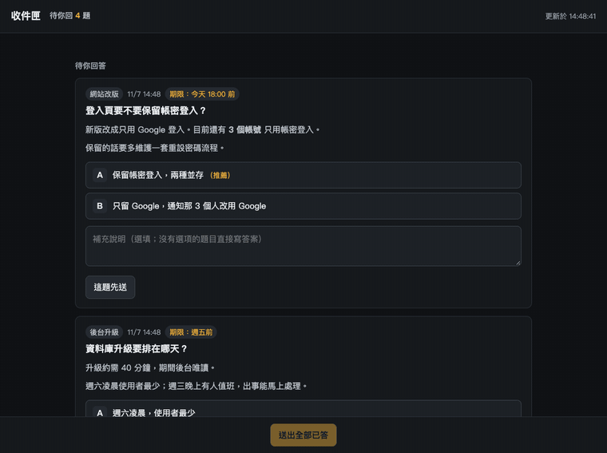
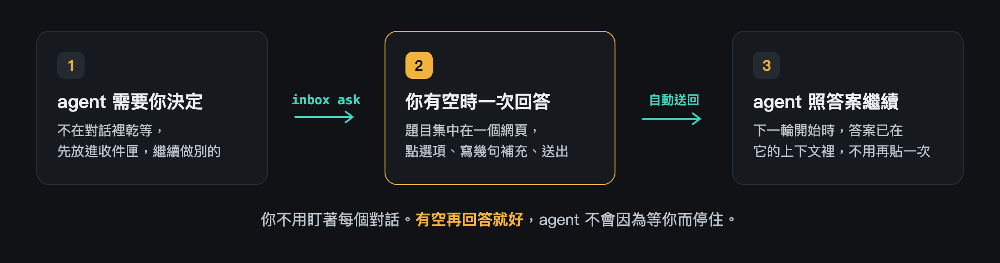
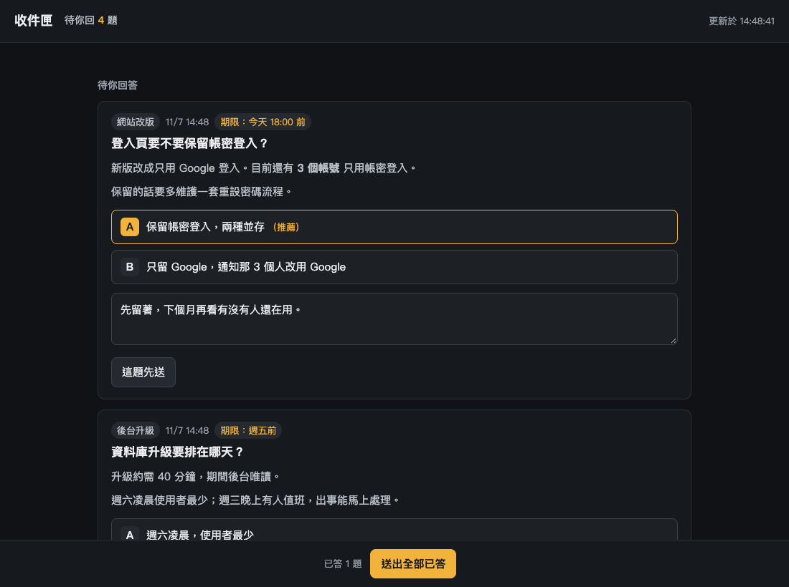
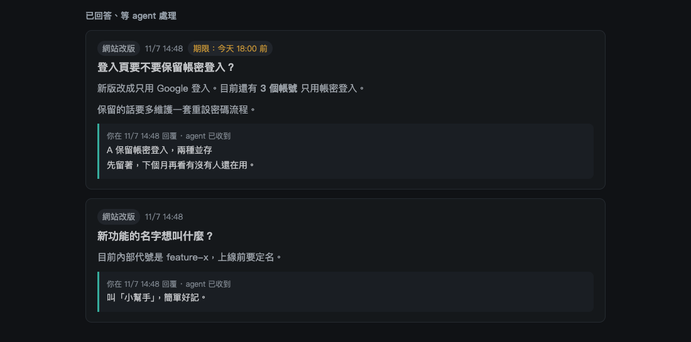
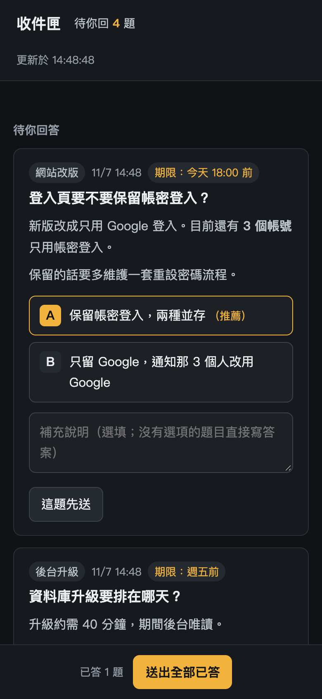

<div align="center">

# 📥 收件匣

### 讓你的 agent 別再停在那邊等你回一句「好」

Claude Code 專用的「決定信箱」：agent 要你拍板的事，統一放進一個網頁。<br>
你有空時一次看完、一次回答，**答案自動回到 agent 手上**。

  



</div>

---

## 你是不是也遇過這些事？

- 讓 agent 跑起來就去吃飯，回來發現它 20 分鐘前就停在「要用 A 還是 B？」
- 同時開了三個對話，每一個都在問你問題，你得一個一個切過去回
- 答案打在對話裡，換個對話它就不知道，隔天又得再解釋一次

**收件匣把「問你」這件事從對話裡拿出來。** agent 繼續做不需要你的部分，要你決定的事排隊放好，你方便的時候再處理。

<div align="center">

</div>

## 長這樣

<div align="center">

</div>

每一題都附上**來源**（哪個專案問的）、**期限**、**推薦選項**和一個補充欄。選好、寫幾句，按「送出全部已答」就好。

<table>
<tr>
<td width="62%" valign="top">

<p align="center"><sub>送出後看得到每題有沒有被 agent 收走</sub></p>
</td>
<td width="38%" valign="top">

<p align="center"><sub>手機版（寬度 390 的實際畫面）</sub></p>
</td>
</tr>
</table>

## 為什麼好用

| | |
|---|---|
| **題目集中** | 所有對話的問題在同一個網頁，來源、期限、推薦選項一眼看完，不用切視窗 |
| **一次回完** | 逐題先送，或一次「送出全部已答」。草稿會自動保存，重新整理也不會掉 |
| **答案自動回去** | 用 Claude Code 的 hook：你送出後，agent 下一輪開始時答案就已經在它的上下文裡，不用你再貼 |
| **不叫 AI、不上雲** | 只用 Python 標準庫。題目就是 agent 寫的那一份，資料全部放在你自己的電腦 |
| **預設安全** | 只開在本機，所有操作都要 token；題目文字一律當純文字顯示，不會被執行 |
| **手機也能回** | 把位址改成你的 Tailscale 或內網位址，就能在手機上回答（見下方進階說明） |

## 30 秒開始

在 Claude Code 裡輸入：

```
/plugin marketplace add ATLab-AllenTeng/claude-pm
/plugin install inbox@claude-pm
```

> 這是 [chenjackle45/claude-inbox](https://github.com/chenjackle45/claude-inbox) 的分支版本，marketplace 名稱是 `claude-pm`，可以和原版同時安裝。

裝好後重開一次 Claude Code，然後對 agent 說：

> 有要我決定的事，就放進收件匣。

就這樣。agent 會自己用 `inbox ask` 出題，並印出網頁網址。想長期生效，把上面那句寫進專案的 `CLAUDE.md`。

**你送出之後，agent 看到的是這樣：**

```
收件匣：使用者回覆了 2 則。

【q-20261107-144835-480d】登入頁要不要保留帳密登入？
使用者選：A 保留帳密登入，兩種並存
補充：先留著，下個月再看有沒有人還在用。

照回覆繼續做；這件處理完可跑 inbox close <題號> 把它收起來。
```

想自己出一題試試看：

```bash
inbox ask --title "要不要上新版？" --option "A=上" --option "B=不上" --recommend A
```

> `inbox` 指令是給 agent 的 Bash 用的。你自己在終端機試的話，改用 `python3 <plugin 資料夾>/inbox/inbox.py`（Windows 用 `python`），後面的參數一樣。

## 你已經有自己的開發規則？疊上去，不要換掉

收件匣不會動你的 `CLAUDE.md`、`AGENTS.md` 或任何現有流程。它只加三樣東西：一個 `inbox` 指令、一個網頁，和一個在每輪開始時把答案送進 agent 的 hook。

所以你原本的規則照舊：哪些事要先問你、哪些事 agent 可以自己決定，都沒有改變，只是「問你」的地方從對話換成收件匣。想讓 agent 這樣用，把下面這段貼進你的 `CLAUDE.md`：

```markdown
## 收件匣
需要問我的事（照上面的規則本來就要問我的那些），一律用 `inbox ask` 放進收件匣，不要在對話裡停下來等。
不需要問我的事，照原本的規則自己決定，不要因為有收件匣就多問。
```

沒有自己的規則也沒關係，直接用預設就行。

## 🎁 附贈：總PM 模式

一個常駐的對話帶好幾條工作線、自己不寫程式，只負責派工、裁決、追進度，而你**只看收件匣**。輸入 `/inbox:pm` 就能看到完整的操作說明，包含狀態檔怎麼寫、什麼事該出題給你、哪些事一定要先問你。

這是給還沒有自己流程的人用的預設做法。你已經有自己的總PM、狀態檔或審查流程時，agent 會沿用你的，只補收件匣那一塊，不會另建一套。

## 不用 Claude Code 也能用（Codex 等其他 agent）

收件匣的核心是一支 Python 指令加一個網頁，不綁 Claude Code。plugin 只是 Claude Code 專用的打包。其他 agent 能在 shell 裡直接跑同一支指令：

```bash
git clone https://github.com/ATLab-AllenTeng/claude-pm
python3 claude-pm/inbox/inbox.py ask --title "要不要上新版？" --option "A=上" --option "B=不上"
python3 claude-pm/inbox/inbox.py wait --timeout 1800   # 有回覆時印出答案並結束
```

其他 agent 沒有 Claude Code 的 hook，答案不會自動出現在上下文，要靠它自己跑 `wait` 或 `take` 去拿。把下面這段貼進它的規則檔（例如 `AGENTS.md`），路徑換成你放的位置：

```markdown
## 收件匣
需要問我的事，用下面的指令放進收件匣，不要在對話裡停下來等：
python3 /path/to/claude-pm/inbox/inbox.py ask --title "..." --option "A=..." --option "B=..."
先做不受這題影響的工作。一定要等答案時，在背景跑 `... inbox.py wait --timeout 1800`。
處理完一題後跑 `... inbox.py close <題號>`。
```

兩個限制：
- 程式靠環境變數 `CLAUDE_CODE_SESSION_ID` 認出題的對話。其他 agent 沒有它，題目會變成匿名，同一個專案資料夾裡的任何 agent 都拿得到答案。兩個 agent 同時在同一個專案出題時，可能拿到對方的答案。
- 這個用法還沒有拿 Codex 等實際跑過，是依程式行為寫的。

## 覺得有用？

按個 ⭐ **Star** 讓更多人看到，也歡迎開 Issue 告訴我哪裡卡住、哪裡想要更好。

---

<details>
<summary><b>進階：從手機看、資料放哪、答案送給哪個對話</b></summary>

### 從手機或別台電腦看

預設只開在本機。人不在那台機器前面時（遠端操作、用手機），有兩種做法。

#### 建議：Tailscale Serve

服務照樣只聽本機，由 [Tailscale Serve](https://tailscale.com/kb/1242/tailscale-serve) 提供 HTTPS 並轉進來。只有你 tailnet 裡的裝置連得到，不會公開到網際網路；本機的 `localhost` 也照常能用。

1. 跑收件匣的機器和你的手機都裝 Tailscale，登入同一個帳號。
2. 在跑收件匣的機器上開代理（`7799` 換成你 `config.json` 裡的 `port`）：

   ```bash
   tailscale serve --bg 7799
   ```

   它會印出一個 `https://機器名.tailnet名.ts.net` 的網址。
3. 把那個網址寫進 `~/.claude-inbox/config.json`：

   ```json
   { "port": 7799, "public_url": "https://機器名.tailnet名.ts.net" }
   ```

4. 重新啟動服務，拿帶 token 的網址：

   ```bash
   inbox stop
   inbox start
   ```

   會印出「外部」和「本機」兩個網址，手機開「外部」那個。之後 agent 出題時給的也是這個網址。

要知道的事：

- **不要用 `tailscale funnel`**。Funnel 會把服務公開到網際網路，那時 token 是唯一的防線。
- **代理會一直開著**，重開機後也在，和收件匣服務有沒有在跑無關。不用時跑 `tailscale serve --https=443 off`。
- **收件匣服務閒置會自己結束**（見下方 `idle_hours`），那時「外部」網址會顯示錯誤頁，到 agent 下次出題才恢復。想讓它一直開著就設 `"idle_hours": 0`。
- **443 已經被你別的 Serve 佔用**時，改用別的埠：`tailscale serve --bg --https=8443 7799`，`public_url` 也要帶上 `:8443`。不能用子路徑（`--set-path`），收件匣的網頁只能放在網址的根。
- `public_url` 只收「協定＋主機＋埠」，不要帶路徑。寫錯時 `inbox url` 會提醒並忽略它。

#### 另一種：直接綁到網路位址

不想用 Serve 的話，可以讓服務直接聽某個位址：

```json
{ "host": "你的 Tailscale 或內網位址", "port": 7799 }
```

這樣走的是沒加密的 HTTP，而且本機要改用那個位址開，`localhost` 會連不上。

> **內網位址要小心。** 收件匣走的是沒加密的 HTTP，token 就在網址裡。Tailscale 的連線本身有加密，可以放心用；一般內網或 Wi-Fi 上，同一個網路的人看得到 token，拿到就能用你的名義回答，等於直接對 agent 下指令。位址不是本機也不是 Tailscale 時，`inbox ask`、`inbox start`、`inbox url` 會印出提醒。

位址只支援 IPv4。token 不分本機或遠端，第一次使用時自動產生，寫進同一個檔（macOS／Linux 上檔案權限 600，資料夾權限 700）。改位址或換 token 後都要重新啟動服務：`inbox stop` 再 `inbox start`。執行中的服務不會自動套用新設定，舊 token 在它重啟前仍然有效。用 `inbox url` 可以印出帶 token 的完整網址。

服務不會一直掛著：沒有等你回答的題目、而且 12 小時沒人連進來，它會自己結束，下次 agent 出題時自動再啟動。要改時間，在 `config.json` 加 `"idle_hours": 小時數`；設 `0` 就不自動結束。

### 更新

Claude Code 不會自動更新這個 marketplace（除非你在 `/plugin` 的 Marketplaces 裡開啟 auto-update）。要拿新版：

```
/plugin marketplace update claude-pm
/reload-plugins
```

更新 plugin 不會重啟已經在跑的收件匣服務。更新後跑一次 `inbox stop`，下次出題會用新程式自動再啟動。

### 資料放哪

`~/.claude-inbox/`（可用環境變數 `CLAUDE_INBOX_HOME` 改）：

| 檔 | 內容 |
|---|---|
| `questions/*.json` | 題目，一題一檔 |
| `events.jsonl` | 你的回答、送達紀錄、收起紀錄；平常只增不改，清理舊題目時才會改寫 |
| `config.json` | 位址、埠、token、閒置幾小時自動結束、多久沒動靜讓別的對話接手、收起的題目留幾天 |
| `sessions/` | 每個對話最後一次有動靜的時間、是否已經結束（檔名是對話代號的雜湊，內容是空的） |

題目與答案都是明文，不要放密碼或金鑰。

資料會自己清：服務啟動時、以及之後每天一次，會刪掉收起超過 30 天的題目和它們的紀錄。還沒回答、或回答了還沒收起的題目放再久也不會刪。要改天數，在 `config.json` 加 `"keep_days": 天數`；設 `0` 就不自動清。想馬上清一次可以跑 `inbox prune`（`--days N` 可以臨時指定天數）。

### 答案送給哪個對話

答案送回出題的那個對話，不管它現在在哪個資料夾。那個對話只是閒置、Claude Code 還開著的話，答案放多久都留給它，你回到那個對話送出下一句時就會收到。

出題的對話結束後（關掉、`/clear`、用 `/resume` 切到別的對話），同一個專案（同一個 git 根目錄）裡的其他對話下一輪就會拿到；同一個對話之後被 resume 回來、答案還沒被拿走的話，還是它自己拿。對話沒正常結束就消失（當機、被強制關掉）時收不到結束通知，改看時間：24 小時沒有任何動靜，同專案的其他對話才接手。要改時間，在 `config.json` 加 `"takeover_hours": 小時數`；設 `0` 就只認結束通知、不靠時間猜。

每則答案成功交給 agent 後就不再送；交到一半被中斷的會在下次重送。

### 安全

- 只收 `Host` 與 `Origin` 符合的請求，擋掉別的網頁偷打你的本機服務。
- 所有 API 都要 token，本機也一樣：答案會被放進 agent 的上下文，不能讓同一台機器上的其他程式隨便寫入。
- 頁面把題目文字當純文字顯示，只有網址會變成連結。
- 回答只在你的機器上流動，沒有任何外送。

### 需求

Python 3.9 以上。答案自動送回 agent 需要 Claude Code；其他 agent 的用法見上方。支援 macOS、Linux、WSL 與原生 Windows，每次推送都會在這三個平台上跑測試。沒有其他依賴。

### 原生 Windows

- **需要 Git for Windows**。Claude Code 在 Windows 上用 Git Bash 跑 hook，收件匣的 hook 與 `inbox` 指令都走 `bin/inbox` 這支 sh 腳本。沒裝 Git Bash 的話 hook 不會執行，答案就不會自動送回 agent（用 GitHub 安裝這個 plugin 本來就需要 git）。
- **需要一個真的能執行的 Python**。`bin/inbox` 依序試 `python3`、`python`、`py -3`。Windows 的 `python3` 常是 Microsoft Store 的捷徑，存在但不能執行，所以腳本會先試跑再決定用哪一個。
- **在 PowerShell 或 cmd 裡**自己下指令時用 `bin\inbox.cmd`，它呼叫的是 `python`。
- **預設埠 7799 可能綁不到**。Hyper-V、WSL、Docker 會保留一段埠範圍，落在裡面的埠沒人在用也綁不到，`server.log` 會寫出原因。用 `netsh interface ipv4 show excludedportrange protocol=tcp` 查，再到 `config.json` 換一個 `port`。
- **沒有 600／700 這種檔案權限**。`~/.claude-inbox`（也就是 `C:\Users\你\.claude-inbox`）的保護靠使用者資料夾本身的存取控制。
- **背景服務是沒有視窗的獨立行程**，關掉終端機不會把它一起關掉；用 `inbox stop` 停。

### 開發

```bash
python3 -m unittest discover tests   # Windows 用 python
```

版號不用自己管：每次有東西合進 `main`，`.github/workflows/bump-version.yml` 會把 `.claude-plugin/plugin.json` 的 patch 版號加一（Claude Code 靠版號判斷要不要更新，版號沒變使用者就拿不到新內容）。要進 minor 或 major 時，在 PR 裡自己改 `version`，那次就不會再自動加。

</details>

## 授權

MIT
